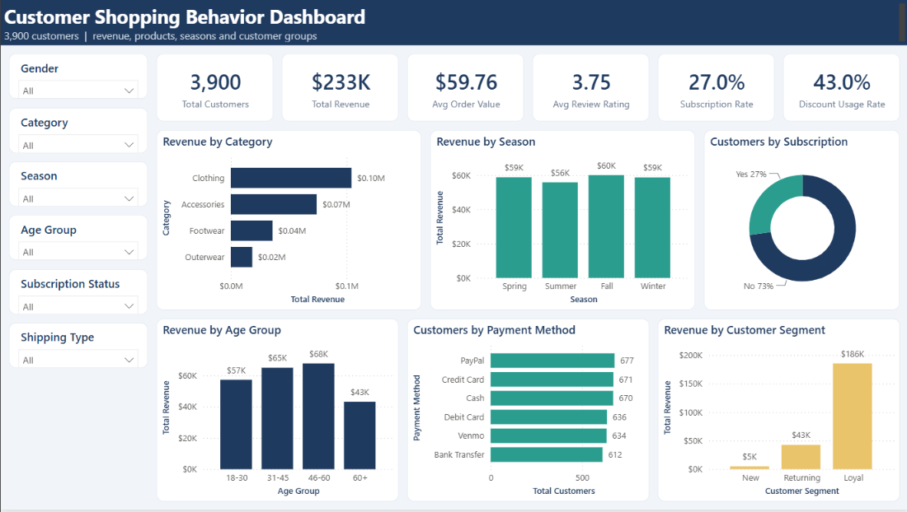
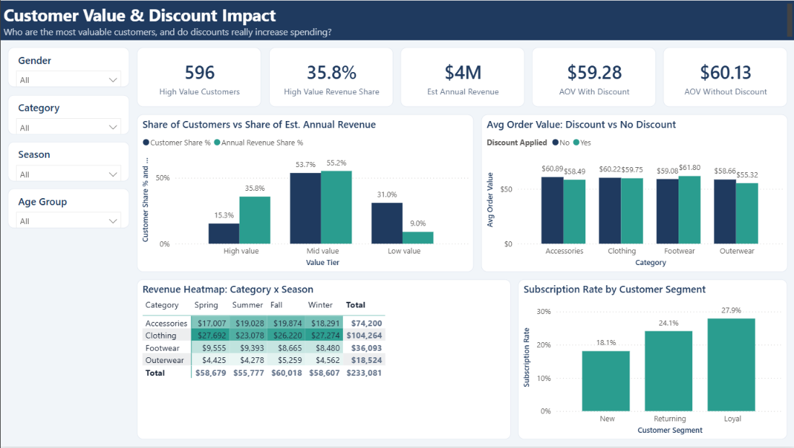
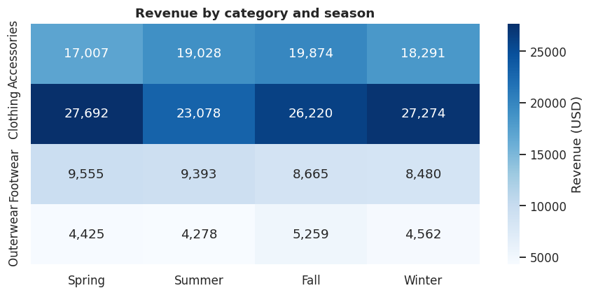
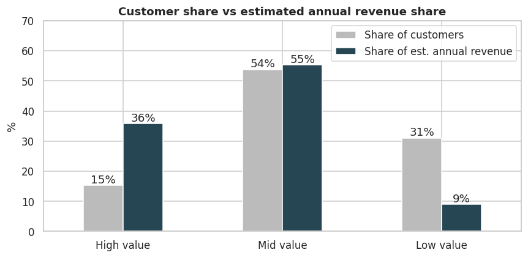
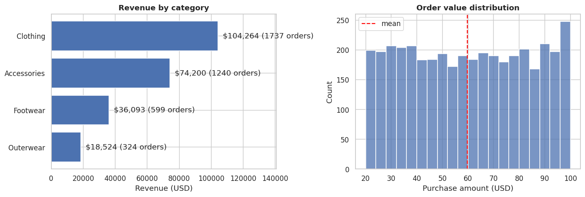
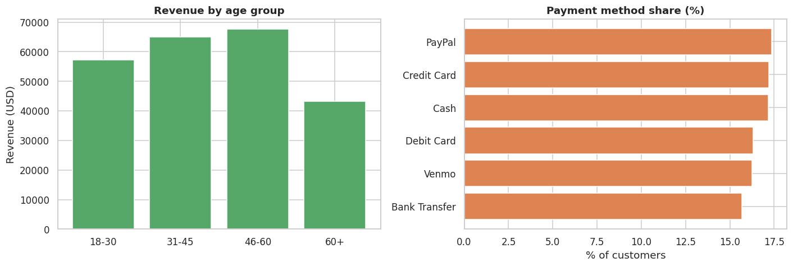
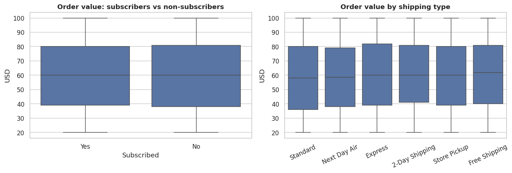
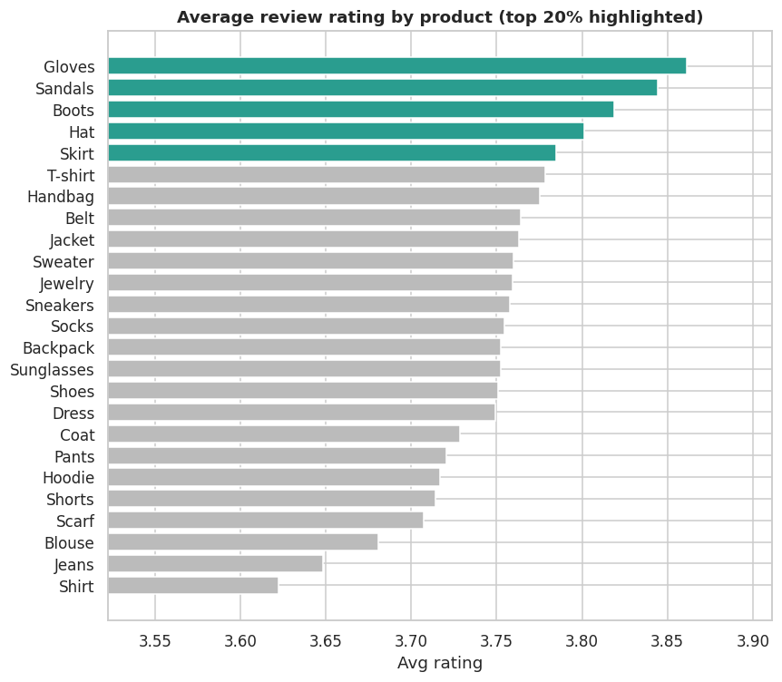

# Customer Shopping Behavior Analysis

A data analysis project on 3,900 retail customer purchases. I used Python to clean the data, SQL to answer
business questions, statistics to check which differences are actually real, and Power BI to put it all into an
interactive dashboard. I built it to practise the full workflow an analyst goes through, from a raw CSV
to recommendations a business could act on.

## Dashboard

**Overview**



**Customer Value & Discounts**



Files: [Power BI file (.pbix)](powerbi/Customer%20Shopping%20Dashboard.pbix) |
[PDF version](powerbi/Customer%20Shopping%20Dashboard.pdf) |
[How I built it](docs/power_bi_dashboard_guide.md)

The report pulls its data from this repository, so the Refresh button works on any machine with internet access.

## Questions I wanted to answer

- Which customers, products and seasons bring in the most revenue?
- Do subscribers spend more than non-subscribers?
- Do discounts make people spend more, or do they just cut into margin?
- Who are the most valuable customers?

## Tools

- **Python** (pandas, NumPy) for cleaning and feature engineering
- **SQL** (SQLite and PostgreSQL) for the business questions, using CTEs and window functions
- **matplotlib and seaborn** for charts
- **SciPy** for hypothesis testing (t-tests, ANOVA, chi-square)
- **Power BI** for the dashboard (Power Query, data modelling, DAX)

## Project structure

```
customer-shopping-behavior-analysis/
├── data/
│   ├── raw/customer_shopping_data_raw.csv
│   └── processed/customer_shopping_data_clean.csv
├── scripts/
│   ├── step1_clean_data.py          cleans the data and builds a SQLite database
│   └── step2_run_sql_queries.py     runs every SQL query and saves the results
├── sql/
│   ├── customer_analysis_queries_sqlite.sql
│   └── customer_analysis_queries_postgresql.sql
├── notebooks/
│   └── customer_shopping_analysis.ipynb   charts, hypothesis tests, segmentation
├── results/
│   ├── sql_query_results.md
│   └── customer_value_tiers.csv
├── powerbi/
│   ├── Customer Shopping Dashboard.pbix
│   ├── Customer Shopping Dashboard.pdf
│   ├── CustomerInsightsTheme.json
│   └── screenshots/
├── docs/
│   └── power_bi_dashboard_guide.md
└── charts/
```

## Running it

```bash
git clone https://github.com/Vishal-Malik-code/customer-shopping-behavior-analysis.git
cd customer-shopping-behavior-analysis
python -m venv .venv
source .venv/bin/activate          # on Windows: .venv\Scripts\activate
pip install -r requirements.txt

python scripts/step1_clean_data.py
python scripts/step2_run_sql_queries.py
jupyter notebook notebooks/customer_shopping_analysis.ipynb
```

SQLite comes with Python, so you don't need to install a database. If you prefer PostgreSQL, load
`data/processed/customer_shopping_data_clean.csv` into a table called `customer` and run
`sql/customer_analysis_queries_postgresql.sql`.

For the dashboard, open the `.pbix` file in Power BI Desktop (free, Windows only).

## Cleaning the data

- Changed the column names to snake_case.
- 37 review ratings were missing. I filled them with the median rating of the same product category,
  because average ratings differ between categories.
- Dropped `promo_code_used`. It had the same value as `discount_applied` on every row.
- Added new columns: age group, days between purchases, estimated purchases per year, and a customer segment
  (New, Returning or Loyal) based on previous purchases.

## Analysis

### SQL

I wrote 16 queries. They cover revenue by gender, age, category and season, the top products in each
category, which products depend most on discounts, state revenue with a running total, payment preferences by
age group, and a customer value score. The full output is in [results/sql_query_results.md](results/sql_query_results.md).

### Are the differences real?

A chart can show two bars of different heights, but that doesn't mean the gap is meaningful. I tested each
idea at a 5% significance level:

| Question | Test | p-value | Answer |
|----------|------|---------|--------|
| Do subscribers spend more per order? | Welch's t-test | 0.66 | No |
| Do discounts change how much people spend? | Welch's t-test | 0.27 | No |
| Does order value change by season? | ANOVA | 0.011 | Yes. Fall is highest ($61.56), Summer lowest ($58.41) |
| Does product category depend on gender? | Chi-square | 0.90 | No |
| Are loyal customers more likely to subscribe? | Chi-square | 0.023 | Yes. 27.9% vs 18.1% for new customers |



### Customer value tiers

I scored every customer from 1 to 4 on three things: how much they spend, how many times they have bought
before, and how often they buy. Adding these up puts each customer into a High, Mid or Low value tier.
I did this in both Python and SQL, and both give the same result.



The High value group is only 15% of customers but brings in about 36% of the estimated yearly revenue.
They also use fewer discounts and subscribe less than average, which means the subscription offer isn't
reaching the best customers.

## What I found

1. Clothing makes up about 45% of revenue and Accessories about 32%, in every season. Outerwear stays below 9%,
   even in winter.
2. 43% of orders used a discount, but discounted orders weren't any bigger. That discount is lost margin.
3. Subscribers don't spend more per order than other customers.
4. Revenue is spread across many states. The top 10 states make up only 23% of it.
5. Every subscriber and every discount user in the data is male. This looks like a data collection issue,
   so I wouldn't draw any gender conclusions until it's checked.

## Recommendations

- Stop giving discounts to everyone. Use them to win back low-value customers, and test removing them for
  Outerwear and Accessories, where they show no benefit.
- Rework the subscription so it offers perks like free express shipping or early access rather than
  savings, and offer it to loyal and high-value customers first.
- Start a VIP programme for the top 15% of customers, since they bring in about a third of revenue.
- Put more campaign and stock planning into Fall and Winter, and look at why Outerwear sells so little.
- Find out why only male customers have subscription and discount records.

## More charts

| | |
|---|---|
|  |  |
|  |  |

## Dataset

A public retail dataset with 3,900 rows and 18 columns covering customer age, gender, location, the item bought,
price, season, review rating, subscription status, shipping type, discount use, payment method and how often
they shop.

## Author

Vishal Malik ([GitHub](https://github.com/Vishal-Malik-code))
